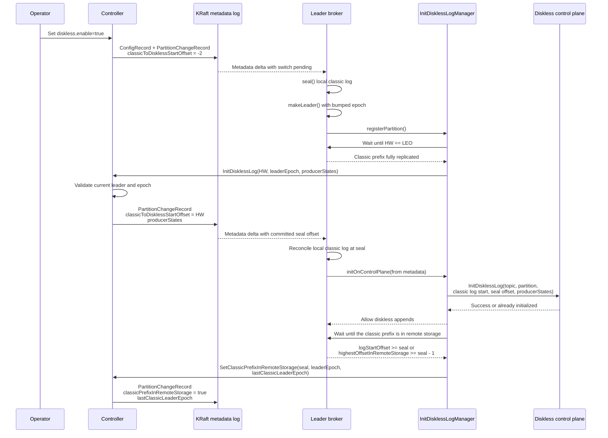

# Classic to Diskless Switch Protocol

This document describes the implementation flow for switching a classic Kafka topic to diskless storage. The switch is driven by metadata records: the controller first marks each partition as switch-pending, the leader seals the local classic log and asks the controller to commit the final start offset, then the broker initializes the diskless log on the control plane from the committed metadata.

Internally, the switch is one of the three features under **TS unification**, together with [managed replicas](FEATURES.md#managed-replicas) and [TS consolidation](DISKLESS_CONSOLIDATION.md).

## Requirements and Guarantees

The switch protocol is designed with the following guarantees and constraints:
* **Online Switch:** The switch is performed online. Producers are blocked only while a partition is sealed but not yet initialized for diskless writes.
* **Zero Data Loss:** The leader waits until the High Watermark (HW) reaches the Log End Offset (LEO) before committing the diskless start offset.
* **Configuration Constraint:** Switching is only supported for topics where unclean leader election is **not enabled**.

The Kafka controller participates in the switch to fence stale leaders. The broker proposes the final start offset, but the controller persists it only if the request comes from the current leader epoch and the current partition leader.

## `classicToDisklessStartOffset` States

`classicToDisklessStartOffset` is a per-partition `long` field on the controller/broker in-memory metadata image (`PartitionRegistration`). It serves two purposes at once:

* As a **boundary**, it marks the first offset owned by diskless storage. The classic log owns every offset below it; diskless storage owns everything at or above it.
* As a **state machine**, it drives the switch flow. Two negative values are used as sentinels, and any non-negative value is the committed boundary:

| Value | Constant | Meaning |
| --- | --- | --- |
| `-1` | `NO_CLASSIC_TO_DISKLESS_START_OFFSET` | No classic-to-diskless switch offset has been committed (the default for classic and born-diskless partitions). |
| `-2` | `CLASSIC_TO_DISKLESS_SWITCH_PENDING` | The switch has started and the classic log must be sealed, but the final diskless start offset has not been committed yet. |
| `>= 0` | — | The committed seal offset. This is the first offset owned by diskless storage; the classic log owns offsets below it. |

### How it is stored

The switch state lives in the KRaft metadata log, but `classicToDisklessStartOffset` is **not** part of the upstream Apache Kafka record schemas (`PartitionRecord`, `PartitionChangeRecord`). To avoid forking those schemas, it is carried as an **unknown tagged field** (`RawTaggedField`) attached to the standard records:

* **High tag numbers (100+).** `classicToDisklessStartOffset` uses tag `100` (`CLASSIC_TO_DISKLESS_START_OFFSET_TAG`). The 100+ range is reserved to avoid colliding with upstream tagged fields. Because the tag is unknown to vanilla Kafka, it is **silently skipped** when read by an upstream broker, which keeps the on-disk metadata format compatible in both directions. Two sibling fields ride along on the same record using the same mechanism: producer states (tag `101`) and the diskless leader epoch (tag `102`).
* **Custom serde in `InitDisklessLogFields`.** The value is encoded by hand into the tagged field's raw byte payload: a single big-endian `int64` (8 bytes) written via `ByteBuffer.putLong`, and read back via `ByteBuffer.getLong`. There is no generated message class for it.
* **Sentinel is normally not serialized.** When `classicToDisklessStartOffset == -1`, automatic paths (`toRecord()` snapshots and ordinary change records) omit the tag entirely to save space; on read, an absent tag decodes back to `-1` (`NO_CLASSIC_TO_DISKLESS_START_OFFSET`).
* **Replay and merge.** On load, `PartitionRegistration` decodes the tag from `PartitionRecord.unknownTaggedFields()`. `merge(PartitionChangeRecord)` applies updates from change records and carries the existing value forward when a change record **omits** the tag. `toRecord()` re-encodes it. `decodeClassicToDisklessStartOffsetIfPresent` returns an empty `OptionalLong` only when the tag is absent, so `merge` keeps the existing value for an omitted tag and applies a present tag verbatim, including an explicit `-1`. Brokers get the value through metadata-log replay and metadata deltas.
* **Phase 2 fields.** The record that starts phase 2 sets `classicPrefixInRemoteStorage` (tag `103`, one byte) and `lastClassicLeaderEpoch` (tag `104`, a big-endian `int32`). The second field is the leader epoch of the record at `classicToDisklessStartOffset - 1`. The record omits tag `104` if the value is `-1`, and an absent tag decodes to `-1`. `merge` keeps both fields when a change record omits them.

## Protocol Steps

### Step 1: mark the switch as pending

When `diskless.enable` changes from `false` to `true`, the controller emits the topic config update and one `PartitionChangeRecord` per partition in the same atomic write. Each partition change sets:

* `classicToDisklessStartOffset = -2`
* `leader = current leader`

Setting the leader to the current leader bumps the leader epoch, which forces the leader broker to process a `makeLeader` transition even when leadership did not otherwise change. Brokers rely on receiving the config change and the pending marker in the same metadata delta.

### Step 2: seal the classic log

When a leader broker applies the metadata delta for a diskless topic with `classicToDisklessStartOffset = -2`, it seals the existing local `Partition` before calling `makeLeader`.

Sealing happens under the `leaderIsrUpdateLock` write lock. If there are undecided transactions, the broker aborts them first; then it marks the partition sealed. Once sealed, `appendRecordsToLeader` rejects classic produce requests with `ReplicaNotAvailableException`, so the local LEO cannot increase.

If the metadata delta also elects a new leader for the partition, the new leader seals before it is placed in the leader role. This prevents the new leader from accepting classic writes during the switch.

### Step 3: propose the final start offset

After sealing, the leader registers the partition with `InitDisklessLogManager`. The manager waits in `WaitingForReplication` until:

* the partition is still sealed
* the local log exists
* `HW == LEO`

Once HW catches up to LEO, the partition moves to `SendingToController`. The broker batches ready partitions and sends `InitDisklessLog` to the controller with:

* `disklessStartOffset = HW`
* `leaderEpoch = current partition leader epoch`
* `producerStates = active producer state extracted from the local log`

At this point `HW == LEO`, so the proposed start offset is the sealed LEO and is safely replicated to the ISR.

### Step 4: persist the final start offset

The controller handles `InitDisklessLog` as a serialized write operation. For each partition, it validates that:

* the request leader epoch is not stale
* the requesting broker is the current leader
* the proposed `disklessStartOffset` is non-negative
* the partition has not already committed a final `classicToDisklessStartOffset`

If validation succeeds, the controller writes a `PartitionChangeRecord` containing the final `classicToDisklessStartOffset` and the producer states. These values are encoded as tagged fields on the partition change record.

If the broker is stale, the controller rejects the request. A lower leader epoch is a permanent failure for that broker's attempt; retriable controller or transport failures are retried by the broker.

### Step 5: initialize the diskless log

After the final offset is committed to the metadata log, brokers receive a new metadata delta with `classicToDisklessStartOffset >= 0`. The local leader then initializes the diskless log on the control plane using the authoritative data from metadata, not the earlier controller response.

The leader calls the control-plane `InitDisklessLog` API with:

* topic ID, topic name, and partition
* local classic log start offset
* committed `classicToDisklessStartOffset`
* committed producer states

Control-plane initialization is batched and retried on transient failures. An `INVALID_REQUEST` response from the control plane is treated as success because it means the diskless log is already initialized.

Once control-plane initialization succeeds, produce requests can use the diskless append path from the committed start offset onward. If `classicPrefixInRemoteStorage` is already `true`, `InitDisklessLogManager` removes the partition from tracking. Otherwise `InitDisklessLogManager` keeps tracking the partition for the next step.

### Step 6: request the `classicPrefixInRemoteStorage` flag

In phase 1, the leader tracks the partition in the `WaitingForUpload` state until the classic prefix is in remote storage. The remote log manager copies closed segments only, in offset order. The manager polls the log once per second to detect the upload. The classic prefix is in remote storage when either of these is true:

* `logStartOffset >= classicToDisklessStartOffset`: the prefix is empty, or retention or `DeleteRecords` already removed it.
* `highestOffsetInRemoteStorage >= classicToDisklessStartOffset - 1`: the remote log manager copied the whole prefix.

When the check passes, the partition moves to `SendingFlagToController`. The broker batches ready partitions and sends `SetClassicPrefixInRemoteStorage` to the controller with these values:

* The seal offset.
* The current leader epoch.
* The leader epoch of the record at `seal - 1`, from the leader epoch cache. The value is `-1` if the log doesn't contain a record below the seal.

The controller sets `classicPrefixInRemoteStorage`, which starts phase 2, and stores the last value as `lastClassicLeaderEpoch`. `InitDisklessLogManager` removes the partition from tracking. For more information about how brokers use the epoch, see [Divergent classic tails in phase 2](#divergent-classic-tails-in-phase-2). If the epoch is below `-1` or higher than the current leader epoch, the controller rejects the request with `INVALID_REQUEST`. No replica's leader epoch cache can hold such an epoch, and every replica would recreate its log on every leader change.

The broker handles the controller response per partition:

* `NONE`: the controller set the flag.
* `INVALID_REQUEST`, `UNKNOWN_TOPIC_ID`, or `UNKNOWN_TOPIC_OR_PARTITION`: the broker stops. The partition isn't in the state the request assumed, and a retry can't change that.
* Any other error, including `FENCED_LEADER_EPOCH` and `NOT_CONTROLLER`: the broker retries with backoff. An epoch bump that keeps the same leader fences the in-flight request. The retry sends the current epoch.

A partition in phase 1 counts toward the `DisklessSwitchedPartitionsPendingUploadCount` controller metric until the controller sets the flag. For more information, see [Controller Metrics](FEATURES.md#controller-metrics).

The leader reports the progress of this step under `kafka.server:type=InitDisklessLogManager`:

* `WaitingForUploadPartitions` and `SendingFlagToControllerPartitions`: the number of partitions in each state.
* `OldestWaitingForUploadAgeMs` and `OldestSendingFlagToControllerAgeMs`: how long the oldest partition has been in each state, or `0` if none is. A growing `OldestWaitingForUploadAgeMs` points to a prefix that the remote log manager doesn't copy.
* `FlagRequestCompletedPerSec`, `FlagRequestFailedPerSec`, and `FlagRequestRetriedPerSec`: per-partition outcomes of the flag request. `FlagRequestFailedPerSec` counts only controller rejections. A request that the broker skips after a leadership change or a topic deletion doesn't count.

`InFlightPartitions` counts only the partitions in steps 3 to 5, so it reaches `0` while partitions still wait for the upload.

## Additional Behavior

Followers also seal during the switch. They use the classic fetcher to replicate the frozen classic prefix while the switch is pending (`-2`). After the controller commits the final start offset, each follower keeps fetching until its local LEO equals the committed seal offset, then hands off from the classic prefix. On a consolidating topic, the follower starts consolidating only in phase 2. For more information, see [Switch phases](#switch-phases).

When a broker applies a newly committed seal offset, it reconciles the local classic log:

* if local LEO is above the seal, it truncates to the seal because offsets at and above the seal belong to diskless storage
* if the partition is in phase 1, this replica is in the ISR, local LEO is at or past the seal, and the high watermark is below it, it advances the high watermark to the seal. In phase 1 the leader admits a replica to the ISR only after a fetch at the seal validated its log, and it requests the seal only after its high watermark reaches its frozen LEO, so the records of such a replica below the seal are the committed ones. A follower doesn't wait for a fetch response with that high watermark: the fetcher drops the response if the seal's leader epoch arrives first, and the leader's fetch session omits a sealed partition from later responses because nothing in it changes. In phase 2 the controller adds replicas to the ISR without checking their logs. A replica there keeps its high watermark and reconciles through a fetch
* if a leader's local LEO is below the seal, it marks the partition offline because the classic prefix is incomplete

If leadership changes while the switch is pending, the new leader seals and re-drives the `InitDisklessLog` controller request. If leadership changes after the controller commits the final offset, the new leader skips the controller step and initializes the control plane directly from metadata. If the flag is still unset, the new leader also rolls its active segment when that segment holds part of the classic prefix, so the remote log manager can copy it. The new leader then watches the upload itself, as in [Step 6](#step-6-request-the-classicprefixinremotestorage-flag).

## Switch phases

A switched partition runs in one of two phases. The `classicPrefixInRemoteStorage` partition flag marks the boundary. The controller applies different rules in each phase, because the classic prefix (the offsets below `classicToDisklessStartOffset`) lives in different places.

* Phase 1 starts when the controller marks the switch pending and ends when the controller sets `classicPrefixInRemoteStorage`. Only the replicas' local disks hold the classic prefix, and the replicas aren't interchangeable.
* Phase 2 starts when the controller sets `classicPrefixInRemoteStorage`. Remote storage holds the classic prefix, and the partition follows the same rules as a born-diskless partition.

| Controller behavior | Phase 1 | Phase 2 |
| --- | --- | --- |
| Leader election | Classic rules: the leader must be an active replica with an online log directory. | Born-diskless rules: any active replica can lead. |
| Unclean leader election | Blocked, even if `unclean.leader.election.enable` is `true`. See [Unclean leader election](#unclean-leader-election). | Allowed if `unclean.leader.election.enable` is `true`, as for a born-diskless topic. |
| ISR expansion when a broker unfences | Skipped. As for a classic partition, only `AlterPartition` expands the ISR. | The controller re-adds the unfenced replica and completes an in-flight reassignment. |
| Reassignment | The controller stages the move as it does for a classic topic. New replicas are adding and dropped replicas are removing until the adding replicas join the ISR. | The target replicas replace the current replicas in one step. |
| `RearmDisklessSwitch` | Accepted only while the switch is pending. See [Re-arm a pending switch](#re-arm-a-pending-switch). | Rejected with `INVALID_REQUEST`. |

The controller sets the flag when it handles a `SetClassicPrefixInRemoteStorage` request from the current leader. In the same record, the controller sets the ISR, can complete a reassignment, and elects a leader if needed. The leader sends this request after the remote log manager uploads the classic prefix, or after retention or `DeleteRecords` removes it. For more information, see [Step 6](#step-6-request-the-classicprefixinremotestorage-flag).

Brokers also follow different rules in each phase. The consolidation rows apply when `diskless.remote.storage.consolidation.enable` is `true`:

| Broker behavior | Phase 1 | Phase 2 |
| --- | --- | --- |
| Consolidation | Off. The partition runs like a switched partition that doesn't consolidate. | On, from the seal. |
| Follower at the seal | Leaves the classic fetcher once it's in the ISR, like a follower that doesn't consolidate. | Leaves the classic fetcher and consolidates from the seal. |
| Replica with a divergent classic prefix | Truncates on the classic fetcher. Only an ISR member can lead. | Deletes and recreates its log before it leads or fetches, and rebuilds it from remote storage. See [Divergent classic tails in phase 2](#divergent-classic-tails-in-phase-2). |
| Local classic prefix | Kept, and serves reads below the seal. | Deleted. Reads below the seal come from remote storage. |
| Metadata routing | Clients go to alive ISR members only. | Clients go to any replica, by the managed replica rules. |

The broker applies the metadata routing rules to every switched partition. The replication factor and the remote storage config don't change them. The broker also applies the phase 1 rule while the switch is pending, because the ISR members are the only replicas with a complete copy of the classic prefix.

### Unclean leader election

In phase 1, only the ISR members store a complete copy of the classic prefix. An unclean leader election makes a replica outside the ISR the leader and resets the ISR to that replica. Until the controller sets `classicPrefixInRemoteStorage`, it blocks unclean leader election for the partition:

* It rejects `unclean.leader.election.enable=true` for the topic with `INVALID_CONFIG`.
* It rejects an `ElectLeaders` request of type `UNCLEAN` with `INVALID_REQUEST`.
* It rejects a reassignment cancellation that needs an unclean leader election with `INVALID_REPLICA_ASSIGNMENT`.
* It skips the unclean election in the other paths that can run one: broker fencing, `AlterPartition`, reassignment cancellation, and the periodic check for leaderless partitions.

These guards also apply if the cluster default enables unclean leader election, which the topic config check doesn't cover. A partition that loses every ISR member has no leader until one of them returns.

### Forced deletion of the local classic prefix

In the record that starts phase 2, the controller adds every live replica to the ISR without checking its local copy of the classic prefix. From then on, brokers trust only the remote copy. When a replica applies the flag, it deletes every local segment below the seal before it serves the prefix or consolidates. If the active segment contains the end of the prefix, the replica rolls it first. This forced deletion skips the retention checks. Like local retention, it advances the local log start offset and keeps the log start offset and the leader epoch cache. The replica keeps serving reads below the seal from remote storage, and the leader keeps validating follower fetches.

The leader requests the flag from its own view of remote storage. A follower learns about uploaded segments from the remote log metadata, which can trail the leader. A tiered read of a segment that this broker's remote log metadata doesn't list fails with `OFFSET_OUT_OF_RANGE`, and the consumer resets its offset. So, like local retention, forced deletion removes only the segments that this broker's highest offset in remote storage covers. The broker retries the rest once per second until its remote log metadata covers them.

In phase 2, a read of the local prefix never returns local records. This rule applies whether or not the broker consolidates. If this broker's remote log metadata covers the offset, a consumer read takes the tiered path. Otherwise, and for every follower fetch, the broker returns `NOT_LEADER_OR_FOLLOWER`, and the client retries. A read can hit the local prefix in these cases:

* The broker updates its metadata cache before it applies the delta, so a fetch can see the flag before the deletion runs.
* The remote log metadata on this broker doesn't cover the prefix yet.
* A fetch that waited in purgatory since phase 1 completes in phase 2.

The broker checks the records that each read returns, not the log offsets before the read. So the rule also holds while the deletion runs and after a log directory move swaps the log. A read that hits the local prefix also queues the deletion again.

A log directory move copies the prefix into the future log, and the deletion on the current log doesn't reach that copy. Before it promotes the future log, the move runs forced deletion on it. Before it copies the first record at the seal, the move rolls the future log, so the prefix and the diskless records never share a segment. The move waits to promote while the future log holds prefix records that the current log no longer serves locally. Otherwise, reads that the current log serves from remote storage would fail after the swap.

A follower below the seal stays on the classic fetcher in phase 2. If the leader already deleted that part of its local log, it returns `OFFSET_MOVED_TO_TIERED_STORAGE`, and the follower rebuilds its log from remote storage. When the follower's local LEO equals the seal, it deletes any part of the prefix it fetched and hands off to consolidation.

If remote storage is off for the topic, or `remote.log.copy.disable` is `true`, the broker keeps the local prefix and logs a warning. Consumer reads succeed only for offsets that this broker already sees in remote storage.

### Divergent classic tails in phase 2

Any replica can join the ISR or lead in phase 2, including one whose local log contains records below the seal that the partition doesn't hold. Such a replica led an older leader epoch and wrote records that the next leader didn't have. An unclean leader election before the switch can also discard records below the replica's high watermark, so the high watermark doesn't identify the replica. Forced deletion keeps the leader epoch cache, and the remote log manager uses that cache to pick remote segments. With a divergent cache, a tiered read fails with `OFFSET_OUT_OF_RANGE` and the consumer resets its offset. On an idle topic, the highest offset in remote storage also stays below the seal, so forced deletion never completes.

The leader that requests the phase 2 flag records the leader epoch of its record at `seal - 1` as `lastClassicLeaderEpoch`. Each leader epoch has one leader, and a follower truncates to the leader's log before it appends. If a replica's leader epoch cache has `lastClassicLeaderEpoch` at `seal - 1`, its records below the seal match the records in remote storage.

If consolidation is on, a replica checks its local log when it first applies the partition and on every new leader epoch. The broker first stops every fetcher of the partition, including the fetcher of a log directory move, so no fetcher changes the logs during the check. They start again after the leadership change. The replica keeps its log only if all of these are true:

* Its last record below the seal, if it has one, is in `lastClassicLeaderEpoch`.
* Consolidation wrote all its records past the seal, in the diskless leader epoch. A replica that missed the seal commit can still hold a classic tail past the seal.
* Its highest offset in remote storage is below its log end offset. That offset only grows, so a replica that uploaded records and then truncated them keeps it. The WAL pruner would then delete diskless batches that consolidation hasn't uploaded yet. The remote log tasks compute that offset without the log lock, and they install it only if the log didn't truncate in the meantime. So a task that read records that a truncation removed, such as the phase 1 truncation to the seal, can't raise the offset after the check.
* If a log directory move runs, its future log ends in the leader epoch that the current log has at the same offset. The broker replaces the current log with the future log once both logs end at the same offset, and it doesn't compare their leader epoch caches. A future log that ends at or below the log start offset of the current log also passes. Retention or `DeleteRecords` can move that log start while a partly copied move waits behind other moves. The current log then holds none of the records of the future log, and the move fetcher drops them on its next fetch.

Otherwise, the broker stops the replica as it stops a deleted partition. It deletes the current and future logs and cancels the remote log tasks of the partition. It keeps the remote log metadata subscription, because the partition stays on the broker. The leadership change in the same metadata delta creates an empty log. The replica then rebuilds its log, leader epoch cache, and producer state from remote storage, like a replica that lost its local log. The new log has no remote progress until the remote log manager computes it from the rebuilt log, so the WAL pruner doesn't delete diskless batches before then. A remote log task that still runs updates only the deleted log. The broker never truncates a log that it keeps, so a kept log only grows.

A storage error can stop the deletion of one of the logs. A future log that the broker didn't delete would restart the log directory move on the new log. So if the broker can't delete both logs or cancel the remote log tasks, it marks the replica offline, as it does after a storage error in a leadership change. The broker cancels the remote log tasks even if a deletion fails, so no copy task keeps the remote progress of the old log.

In phase 2, every rebuild from remote storage starts the local log at the seal. Upstream tiered storage looks up the remote segment that holds the record before the local log start of the source. A classic leader or the current log of a log directory move can still hold local records below the seal, and a segment from a discarded epoch can hold that record too. The tier-state machine looks up the segment that holds `seal - 1` in `lastClassicLeaderEpoch` instead, whatever the local log start of the source is. Each leader epoch has one leader, so the records of that segment below the seal are the committed prefix, even if the segment also covers discarded records past the seal:

* The tier-state machine keeps the epochs of that segment that start below the seal.
* If the segment ends past the seal, the tier-state machine doesn't restore its producer snapshot. The producer state starts empty at the seal. Sealing aborts undecided transactions, and no transaction is open there.
* A leader then reads the records from the seal on through consolidation. A follower on the classic fetcher ends at the seal and hands off to consolidation. For more information, see [Forced deletion of the local classic prefix](#forced-deletion-of-the-local-classic-prefix).

The record that starts phase 2 bumps the leader epoch. Live replicas then become the leader or followers of a new leader epoch, and run the check. A replica that is offline then, or that a reassignment adds later, runs it when it first applies the partition. Changes that keep the leader epoch, such as ISR changes, don't restart the fetchers, and the replica skips the check for them.

For a replica whose log ends below the seal, the check compares the epoch of its last record. The broker recreates such a replica if its last record is in an older epoch, even when its records match, which costs only the rebuild. Replicas skip the check if `lastClassicLeaderEpoch` is `-1`, and their rebuilds use the upstream lookup. These partitions keep the behavior from before the check. The value is `-1` in these cases:

* The prefix was empty when the leader requested the flag, or retention had already removed it.
* A leader or a controller without this field set the flag before or during a rolling upgrade.
* A controller without this field wrote a metadata snapshot. A node that doesn't know tag `104` drops it from the snapshots that it writes.

The controller sets the flag only once and doesn't record the epoch for these partitions later.

After an unclean leader election before the switch, a remote segment can cross the seal and hold discarded records past it. A tiered read that starts below the seal ends at the seal: the broker returns only the whole batches that end below it, and the consumer reads the diskless records from the seal on.

## Re-arm a pending switch

Every step of the switch runs on the leader, and no operator command sets the seal offset or changes the control plane. Only the leader knows its log end offset and the producer states that the seal commits.

If a switch doesn't leave the pending state, you can restart it without moving the leader. Run `kafka-topic-switch.sh rearm --topic <topic> --partition <partition>` with `--bootstrap-server` or `--bootstrap-controller`. The command sends the `RearmDisklessSwitch` controller RPC. The request contains only the topic and the partition. The controller authorizes the RPC as `ALTER` on the cluster. The controller writes a `PartitionChangeRecord` that keeps `classicToDisklessStartOffset` at `-2` and re-sets the leader, which bumps the leader epoch. The leader then seals again and re-drives `InitDisklessLog`, as after any leadership change while the switch is pending. A leader election has the same effect.

The controller rejects the request with `INVALID_REQUEST` in these cases:

* The topic doesn't have `diskless.enable=true`.
* The switch of the partition isn't pending: `classicToDisklessStartOffset` is `-1` or a committed seal.

To see the switch state of each partition, run `kafka-topic-switch.sh state --topic <topic>`.
